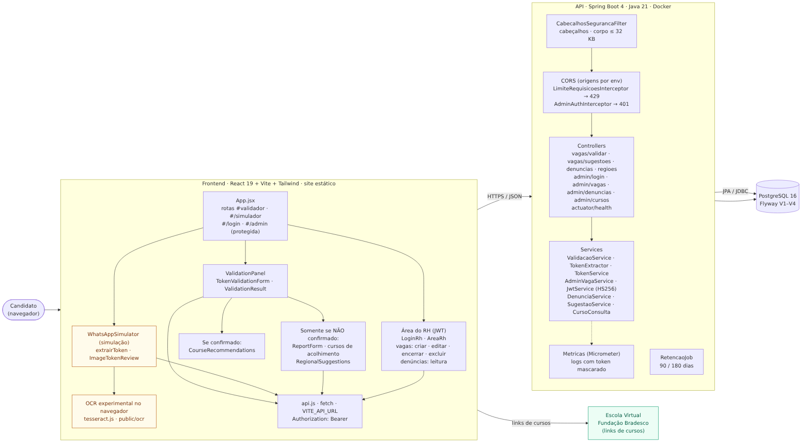
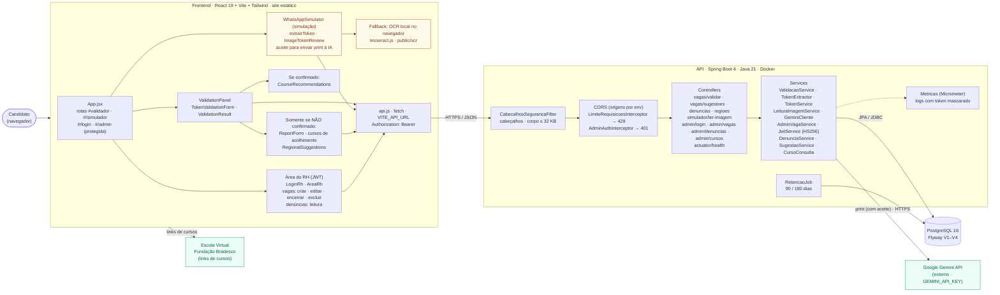

# Diagrama de arquitetura — Antigolpe

> Protótipo acadêmico, **não oficial**. Atualizado na Sprint 10 (2026-11-17) para refletir o código entregue.

O site (React) chama a API (Spring Boot), que consulta o PostgreSQL. A vaga é identificada **só pelo
token**, procurado pelo código no banco. O RH administra as vagas numa área protegida por login (JWT). O simulador de chat (em amarelo) é uma **simulação**; com o aceite da pessoa, o print é lido pelo
**Google Gemini** através do backend (a chave nunca vai ao navegador) e, se a IA falhar, pelo OCR local. A Escola Virtual da Fundação Bradesco aparece
apenas como destino de links de cursos: não há integração.

Fonte Mermaid

## Camadas

| Camada | Tecnologia | Responsabilidade |
|---|---|---|
| Cliente | React 19, Vite, Tailwind (site estático) | Validador (campo único), resultado, denúncia e sugestões (só no não confirmado), cursos, alto contraste, simulador de chat com OCR experimental |
| Comunicação | `api.js` (fetch/JSON), `VITE_API_URL` | Erros no formato `{ mensagem }`; 0/503 nunca viram resultado negativo |
| Borda da API | `CabecalhosSegurancaFilter`, CORS, `LimiteRequisicoesInterceptor` | Cabeçalhos de segurança, corpo ≤ 32 KB, origens permitidas, 429 por cliente |
| API | Controllers → Services → Repositories (Spring Boot 4, Java 21) | Regras de validação, denúncia, sugestões, cursos; DTOs separados das entidades |
| Dados | PostgreSQL 16 + Flyway (V1–V4); H2 só em testes/demonstração | Ver [MER](mer.md) e [DER](der.md) |
| Área do RH | `#/login`, `#/admin`; `AdminAuthInterceptor` + `JwtService` | Gestão de vagas e leitura de denúncias, só com JWT válido |
| Operação | Actuator (`/actuator/health`), Micrometer, `RetencaoJob` | Health check, métricas sem dados sensíveis, retenção 90/180 dias |
| Deploy (preparado) | `render.yaml`, `backend/Dockerfile` | API Docker, site estático, PostgreSQL gerenciado — ver [DEPLOY](DEPLOY.md) |

## Endpoints

| Método | Rota | Uso |
|---|---|---|
| POST | `/api/vagas/validar` | Validação de token, link ou texto (link nunca acessado) |
| POST | `/api/denuncias` | Denúncia opcional (protocolo `AG-…`), não enviada a terceiros |
| GET | `/api/vagas/sugestoes?uf=` | Até 3 vagas publicadas (UF escolhida → remotas) |
| GET | `/api/regioes` | 27 UFs para escolha manual |
| POST | `/api/admin/login` | Login do RH (`root`/`root`) → JWT de 8 h |
| GET/POST | `/api/admin/vagas` | Listar / criar vaga (gera token) — requer JWT |
| GET/PUT/DELETE | `/api/admin/vagas/{id}` | Ver / editar / excluir vaga — requer JWT |
| POST | `/api/admin/vagas/{id}/encerrar` | Encerrar vaga — requer JWT |
| GET | `/api/admin/denuncias`, `/api/admin/cursos` | Denúncias (leitura) e catálogo de cursos — requer JWT |
| GET | `/actuator/health` | Health check |

Contrato completo: [`contracts/api.yaml`](../contracts/api.yaml).

## Fluxo de uma validação

1. A pessoa cola o token, o link ou a mensagem (ou, no simulador, anexa um print lido por OCR no navegador e revisa o token).
2. `POST /api/vagas/validar` → `TokenExtractor` localiza o candidato (`BRD-…`) só por texto.
3. O banco é consultado pelo código do token (texto, D056). Confirma somente se o token estiver ativo, vigente, a vaga publicada e o prefixo regional coincidir.
4. A validação é registrada sem o token (`validacao`), e as métricas são incrementadas.
5. **Confirmado:** cargo, região e cursos da vaga, com aviso de que isso não garante a autenticidade da mensagem.
6. **Não confirmado:** a mesma resposta para não encontrado, expirado, revogado e vaga encerrada (anti-enumeração), nunca "golpe"; o site mostra orientação, denúncia opcional, cursos de segurança e sugestões regionais.
