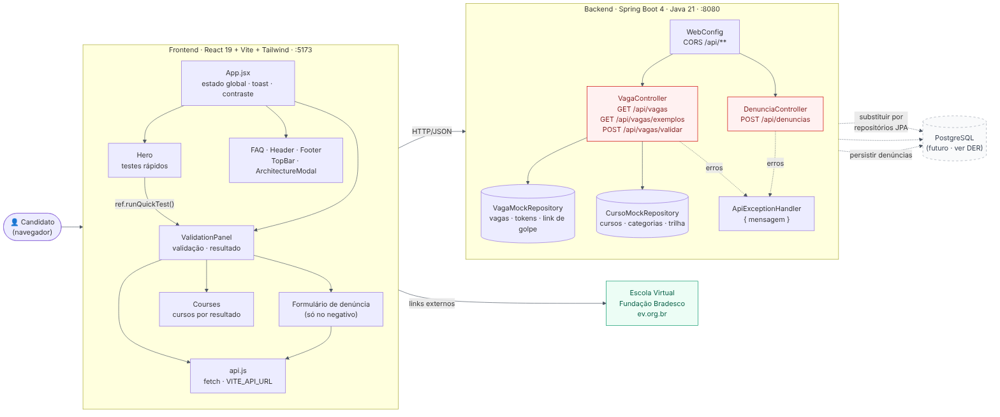
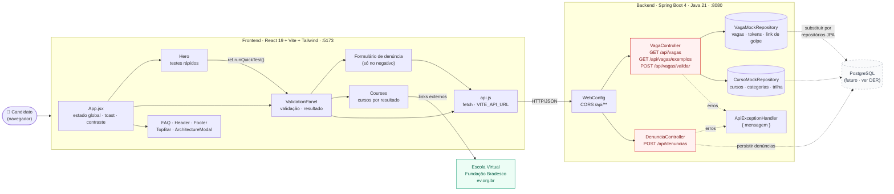

# Diagrama de arquitetura — Antigolpe

Visão do protótipo **como está hoje**: o frontend React consome uma API Spring Boot que serve
dados mockados em memória. As setas tracejadas mostram onde o PostgreSQL entra quando o banco
for desenvolvido (ver [MER](mer.md) e [DER](der.md)).

Fonte Mermaid

## Camadas

| Camada | Tecnologia | Responsabilidade |
|---|---|---|
| Cliente | React 19 + Vite + Tailwind (porta 5173) | Interface, seletor de cargo, validação, denúncia (só no resultado negativo) e cursos (só após validar) |
| Comunicação | `api.js` (fetch, JSON) | Chamadas HTTP para a API; URL em `VITE_API_URL` |
| API | Spring Boot 4 / Java 21 (porta 8080) | Endpoints REST, CORS, tratamento de erros `{ mensagem }` |
| Dados (hoje) | `VagaMockRepository`, `CursoMockRepository` | Vagas, tokens, cursos, categorias e trilha de segurança em memória |
| Dados (futuro) | PostgreSQL | Mesmo conteúdo dos mocks + persistência das denúncias |
| Externo | Escola Virtual da Fundação Bradesco | Links do catálogo de cursos |

## Endpoints

| Método | Rota | Controller | Uso no front |
|---|---|---|---|
| GET | `/api/vagas` | VagaController | Preenche o seletor de cargo |
| GET | `/api/vagas/exemplos` | VagaController | Botões "Simular Vaga Válida" e "Simular Golpe / Phishing" |
| POST | `/api/vagas/validar` | VagaController | Valida token/link e devolve os cursos recomendados |
| POST | `/api/denuncias` | DenunciaController | Envia a denúncia simulada e devolve o protocolo |

## Fluxo de uma validação

1. O candidato escolhe o cargo e informa o token ou link.
2. `ValidationPanel` chama `POST /api/vagas/validar`.
3. `VagaController` busca a vaga e o dono do token em `VagaMockRepository` e monta os cursos com `CursoMockRepository`.
4. **Válido:** o front mostra os cursos do cargo abaixo do validador, sem rolar a tela.
5. **Não confirmado:** o front mostra a denúncia e os cursos de acolhimento lado a lado e rola até eles. A denúncia vai para `POST /api/denuncias`.
