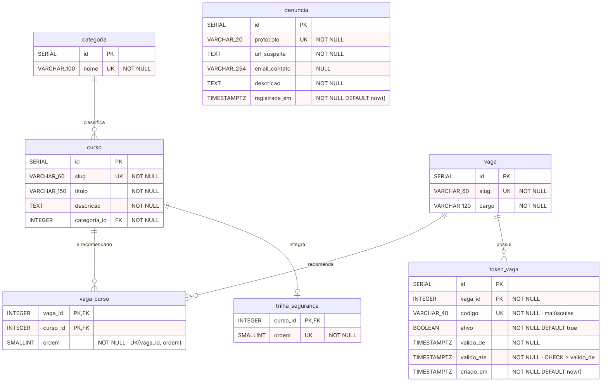
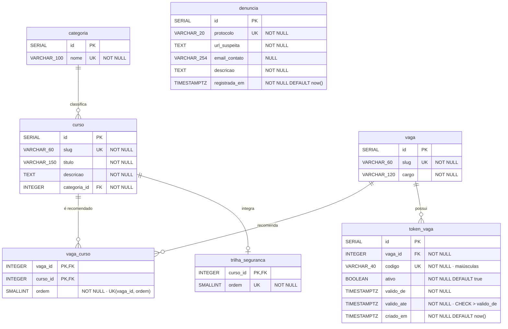

# DER — Diagrama Entidade-Relacionamento (lógico · PostgreSQL)

Base para criar o banco. Derivado do [MER](mer.md) e dos mocks atuais do backend.

Fonte Mermaid

Convenções:
- No diagrama, `VARCHAR_100` significa `VARCHAR(100)`, porque o Mermaid não aceita parênteses no tipo.
- PK = chave primária · FK = chave estrangeira · UK = único.
- Chaves primárias são `SERIAL`. O `slug` (o id de texto que a API usa hoje, ex. `seguranca-informacao`) fica como coluna única.

## Dicionário de dados

### `categoria`
| Coluna | Tipo | Restrições | Descrição |
|---|---|---|---|
| id | SERIAL | PK | Identificador |
| nome | VARCHAR(100) | NOT NULL, UNIQUE | Nome da categoria do catálogo |

### `curso`
| Coluna | Tipo | Restrições | Descrição |
|---|---|---|---|
| id | SERIAL | PK | Identificador |
| slug | VARCHAR(60) | NOT NULL, UNIQUE | Id usado pela API (ex. `java-basico`) |
| titulo | VARCHAR(150) | NOT NULL | Título do curso |
| descricao | TEXT | NOT NULL | Resumo exibido no card |
| categoria_id | INTEGER | NOT NULL, FK → categoria.id | Categoria do curso |

### `vaga`
| Coluna | Tipo | Restrições | Descrição |
|---|---|---|---|
| id | SERIAL | PK | Identificador |
| slug | VARCHAR(60) | NOT NULL, UNIQUE | Id usado pela API (ex. `recursos-humanos`) |
| cargo | VARCHAR(120) | NOT NULL | Nome do cargo |

### `vaga_curso` (associativa: recomenda)
| Coluna | Tipo | Restrições | Descrição |
|---|---|---|---|
| vaga_id | INTEGER | PK, FK → vaga.id | Vaga |
| curso_id | INTEGER | PK, FK → curso.id | Curso recomendado |
| ordem | SMALLINT | NOT NULL, UNIQUE (vaga_id, ordem) | Posição do curso na lista da vaga |

### `token_vaga`
| Coluna | Tipo | Restrições | Descrição |
|---|---|---|---|
| id | SERIAL | PK | Identificador |
| vaga_id | INTEGER | NOT NULL, FK → vaga.id | Vaga confirmada pelo token |
| codigo | VARCHAR(40) | NOT NULL, UNIQUE | Código do token, gravado em maiúsculas |
| ativo | BOOLEAN | NOT NULL, DEFAULT true | Permite desativar sem apagar |
| valido_de | TIMESTAMPTZ | NOT NULL | Início da validade |
| valido_ate | TIMESTAMPTZ | NOT NULL, CHECK (valido_ate > valido_de) | Fim da validade |
| criado_em | TIMESTAMPTZ | NOT NULL, DEFAULT now() | Data de cadastro |

### `trilha_seguranca`
| Coluna | Tipo | Restrições | Descrição |
|---|---|---|---|
| curso_id | INTEGER | PK, FK → curso.id | Curso que integra a trilha |
| ordem | SMALLINT | NOT NULL, UNIQUE | Posição na trilha |

### `denuncia`
| Coluna | Tipo | Restrições | Descrição |
|---|---|---|---|
| id | SERIAL | PK | Identificador |
| protocolo | VARCHAR(20) | NOT NULL, UNIQUE | Protocolo devolvido ao usuário (hoje `DEMO-` + 8 caracteres) |
| url_suspeita | TEXT | NOT NULL | Link ou token denunciado |
| email_contato | VARCHAR(254) | NULL | E-mail opcional do denunciante |
| descricao | TEXT | NOT NULL | Detalhes informados |
| registrada_em | TIMESTAMPTZ | NOT NULL, DEFAULT now() | Data do registro |

## Regras que o banco precisa suportar

Tiradas do comportamento atual do backend e das definições deste modelo:

1. **Token válido** = `codigo` igual ao informado (comparado em maiúsculas), `ativo = true`, `now()` entre `valido_de` e `valido_ate`, e `vaga_id` igual à vaga selecionada.
2. **Token de outra vaga:** se o código existe mas pertence a outra vaga, o resultado é `NAO_CONFIRMADO` com mensagem própria. Por isso `codigo` é único no banco todo.
3. **Cursos no resultado válido:** `vaga_curso` da vaga, ordenado por `ordem`.
4. **Cursos no resultado não confirmado:** `trilha_seguranca` por `ordem` e depois `vaga_curso` da vaga por `ordem`, sem repetir curso.

## De onde vem cada dado hoje

| Tabela | Origem atual no código |
|---|---|
| vaga, token_vaga | `VagaMockRepository` (4 vagas, 1 token cada) |
| curso, categoria, vaga_curso, trilha_seguranca | `CursoMockRepository` (12 cursos, 4 categorias, trilha com 3 cursos) e a lista de cursos de cada `VagaMock` |
| denuncia | Não é salva; `DenunciaController` só gera o protocolo |

Os tokens atuais não têm período de validade. Na carga inicial, `valido_de` e `valido_ate`
precisarão de datas definidas por você.

## Fora do modelo

- Os exemplos dos testes rápidos (`GET /api/vagas/exemplos`, incluindo o link de golpe) não foram modelados e continuam no código.
- Não há histórico de validações, e a denúncia não referencia vaga nem validação.
- O comportamento de `ON DELETE` das chaves estrangeiras não foi definido. O padrão do PostgreSQL (`NO ACTION`) impede apagar uma linha que ainda é referenciada.
