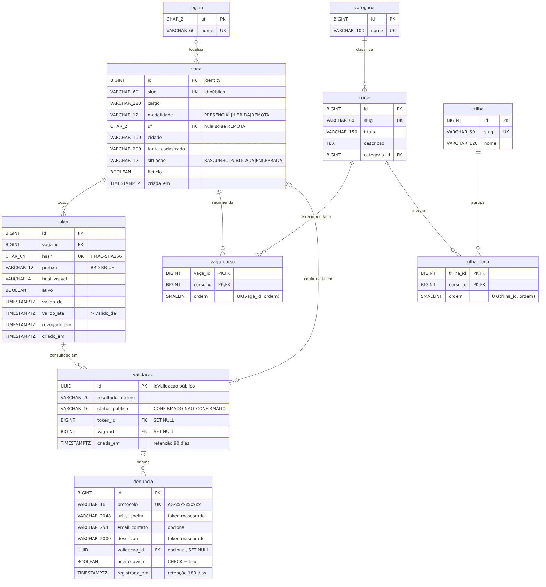
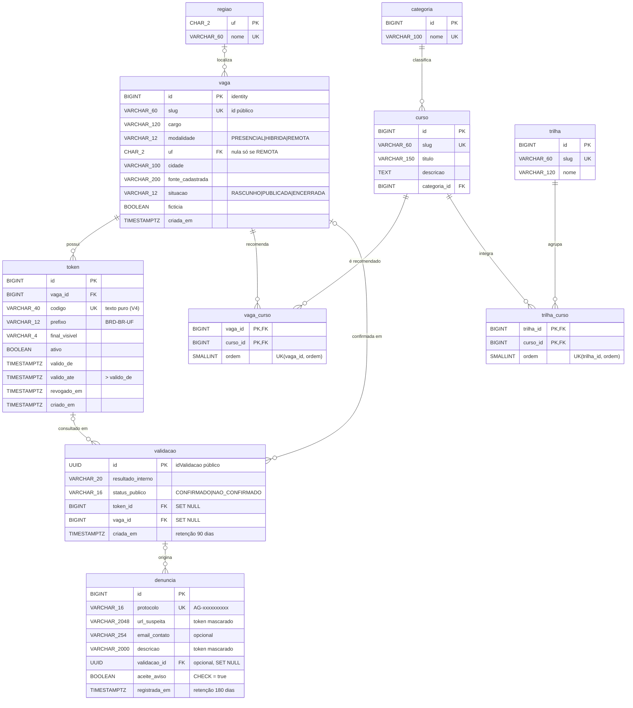

# DER — Diagrama Entidade-Relacionamento (lógico · PostgreSQL)

> Atualizado na Sprint 11 (2026-11-17) a partir das migrations `V1__esquema_inicial.sql`,
> `V3__validacao_e_denuncia.sql` e `V4__token_em_texto.sql` (`V2` só insere dados de referência). O banco é criado e alterado
> **somente** pelo Flyway; o Hibernate apenas valida (`ddl-auto=validate`).

Fonte Mermaid

## Regras garantidas pelo banco

| Tabela | Restrição |
|---|---|
| `vaga` | `modalidade` ∈ PRESENCIAL/HIBRIDA/REMOTA; `situacao` ∈ RASCUNHO/PUBLICADA/ENCERRADA; `uf` obrigatória exceto em REMOTA; `slug` único |
| `token` | `codigo` em texto puro e único (V4, D056 — antes era só o hash HMAC); `prefixo` no formato `BRD-BR-__`; `valido_ate > valido_de` |
| `vaga_curso`, `trilha_curso` | Chave composta; `ordem` única por vaga/trilha |
| `validacao` | `status_publico` ∈ CONFIRMADO/NAO_CONFIRMADO; `resultado_interno` em lista fechada; referências viram `NULL` se o token/vaga for removido |
| `denuncia` | `protocolo` único; `aceite_aviso = true`; ligação opcional com a validação |

## Índices

`ix_vaga_uf_situacao` (sugestões por UF), `ix_token_vaga`, `ix_validacao_criada_em` e
`ix_denuncia_registrada_em` (limpeza por retenção).

## Mudanças em relação ao DER preliminar (out/2026)

- `token_vaga.codigo` (texto em claro) → `token.hash` + `prefixo` + `final_visivel` (D019).
- `trilha_seguranca` → `trilha` + `trilha_curso` (várias trilhas possíveis) (D018).
- Novas: `regiao`, `validacao`; `vaga` ganhou modalidade, UF, cidade, fonte, situação e `ficticia`.
- `denuncia` ganhou `aceite_aviso` e `validacao_id`; textos limitados a 2048/2000 caracteres.
