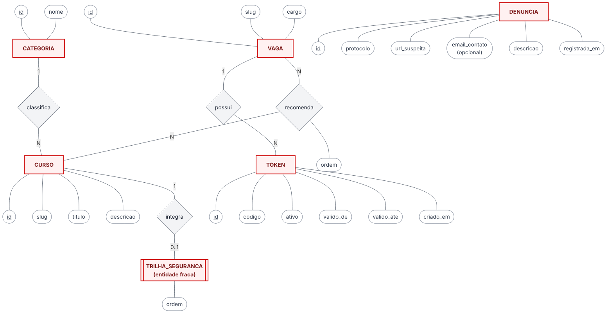
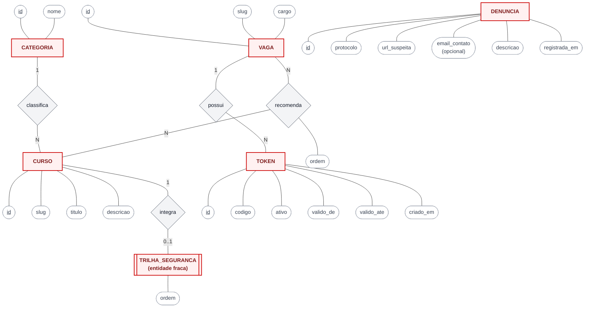

# MER — Modelo Entidade-Relacionamento (conceitual)

Modelo conceitual em notação de Chen, independente de banco. A versão lógica para PostgreSQL,
com tipos e chaves, está no [DER](der.md).

Fonte Mermaid

Legenda: retângulo = entidade · retângulo duplo = entidade fraca · losango = relacionamento ·
elipse = atributo · <u>sublinhado</u> = identificador.

## Entidades

| Entidade | Descrição | Atributos |
|---|---|---|
| **VAGA** | Oportunidade fictícia de um cargo | <u>id</u>, slug, cargo |
| **TOKEN** | Código que confirma uma vaga; uma vaga pode ter vários | <u>id</u>, codigo, ativo, valido_de, valido_ate, criado_em |
| **CURSO** | Curso sugerido (nome do catálogo da Escola Virtual) | <u>id</u>, slug, titulo, descricao |
| **CATEGORIA** | Categoria do catálogo (ex.: Tecnologia da Informação, Programação) | <u>id</u>, nome |
| **TRILHA_SEGURANCA** | Cursos de segurança mostrados quando a vaga não é confirmada; depende de CURSO | ordem |
| **DENUNCIA** | Denúncia de link ou token suspeito | <u>id</u>, protocolo, url_suspeita, email_contato (opcional), descricao, registrada_em |

## Relacionamentos

| Relacionamento | Entidades | Cardinalidade | Leitura |
|---|---|---|---|
| **possui** | VAGA – TOKEN | 1 : N | Uma vaga possui vários tokens; cada token pertence a uma única vaga |
| **recomenda** | VAGA – CURSO | N : N, com atributo **ordem** | Uma vaga recomenda vários cursos em ordem; um curso pode ser recomendado por várias vagas |
| **classifica** | CATEGORIA – CURSO | 1 : N | Uma categoria classifica vários cursos; cada curso tem uma categoria |
| **integra** | CURSO – TRILHA_SEGURANCA | 1 : 0..1 | Um curso pode integrar a trilha de segurança, com uma posição (ordem) |

A **DENUNCIA** não se relaciona com as outras entidades: hoje ela guarda só o link denunciado,
sem referência à vaga ou à validação.
