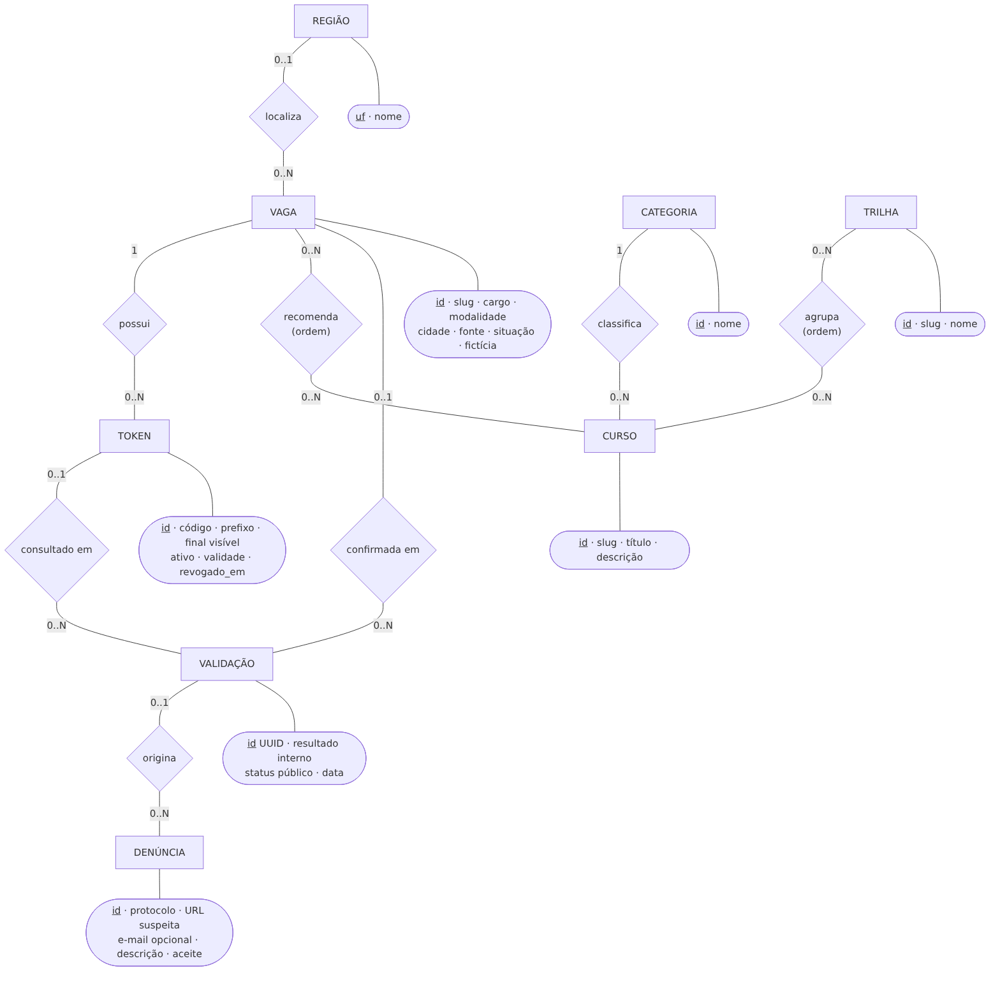
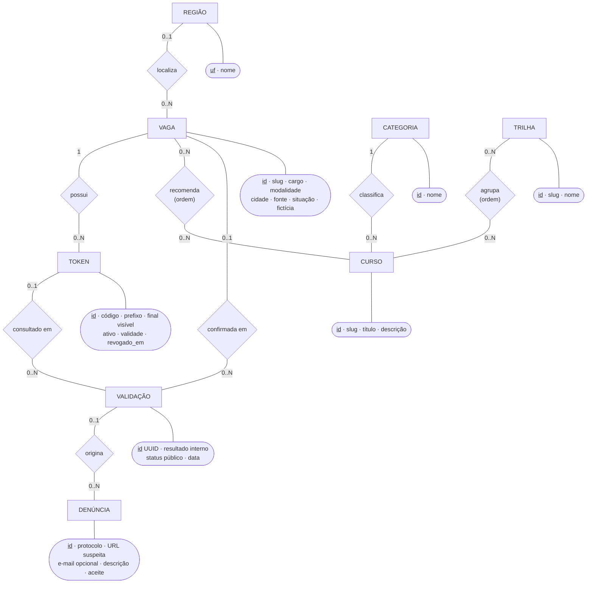

# MER — Modelo Entidade-Relacionamento (conceitual)

> Atualizado na Sprint 10 (2026-11-17). Modelo conceitual (notação de Chen), independente de banco.
> A versão lógica, com tipos e chaves, está no [DER](der.md).

Fonte Mermaid

## Entidades

| Entidade | O que representa |
|---|---|
| REGIÃO | Unidade federativa (27 UFs) |
| VAGA | Oportunidade cadastrada no protótipo (fictícia nos dados de demonstração) |
| TOKEN | Código entregue ao candidato, gerado ao criar a vaga; guardado em texto (visível ao RH), com validade e revogação |
| CURSO / CATEGORIA | Cursos do catálogo público da Escola Virtual (só título e categoria; sem carga horária) |
| TRILHA | Sequência de cursos (ex.: segurança, mostrada no resultado não confirmado) |
| VALIDAÇÃO | Registro mínimo de cada consulta: resultado e data, sem o texto consultado |
| DENÚNCIA | Relato opcional do candidato, com protocolo e aviso de privacidade aceito |

## Relacionamentos

- Uma vaga fica em **0 ou 1** região (vagas remotas podem não ter UF) e tem **0..N** tokens.
- Vaga e curso: **N:N** com ordem (`recomenda`); trilha e curso: **N:N** com ordem (`agrupa`).
- Uma validação aponta para **0 ou 1** token e **0 ou 1** vaga (só a vaga quando confirmada).
- Uma denúncia pode nascer de **0 ou 1** validação: ofertas não cadastradas também podem ser denunciadas.
